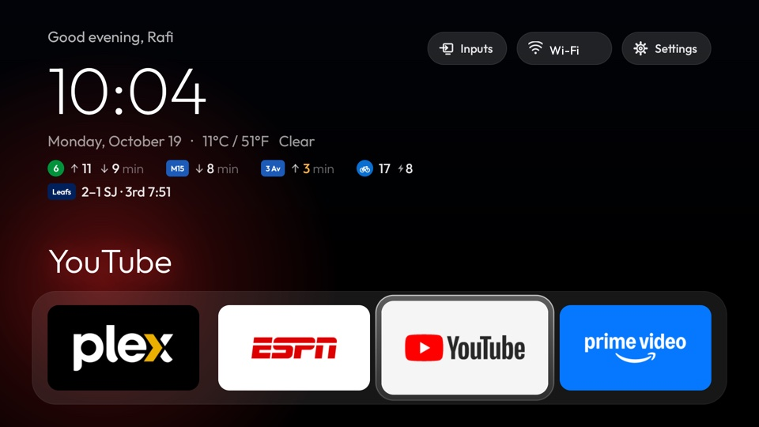
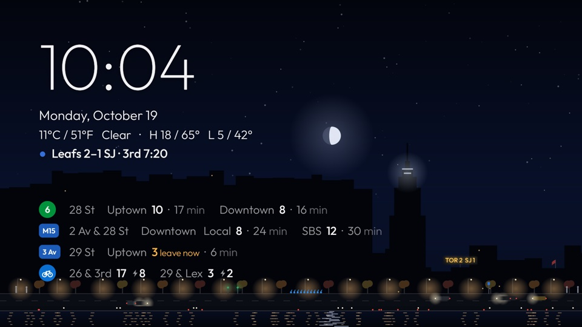
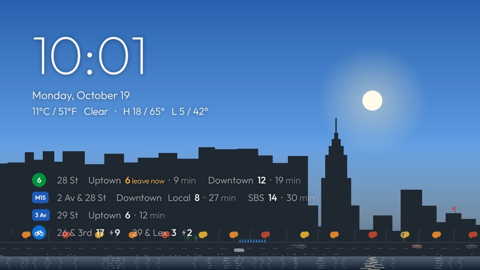
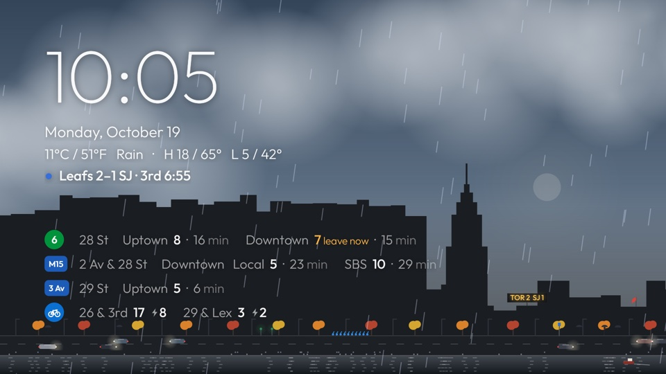
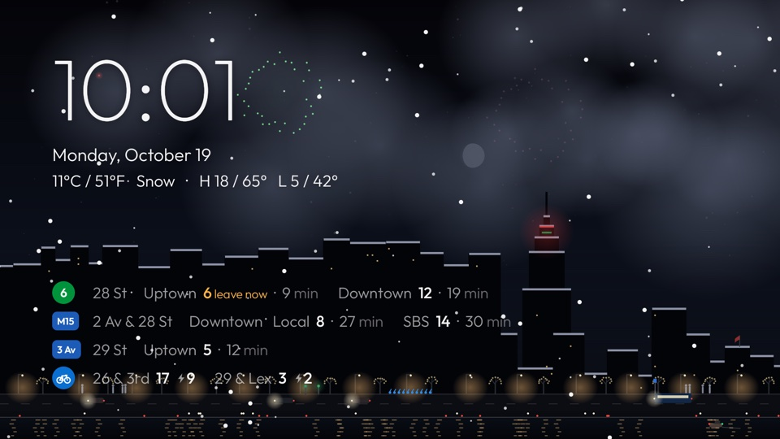
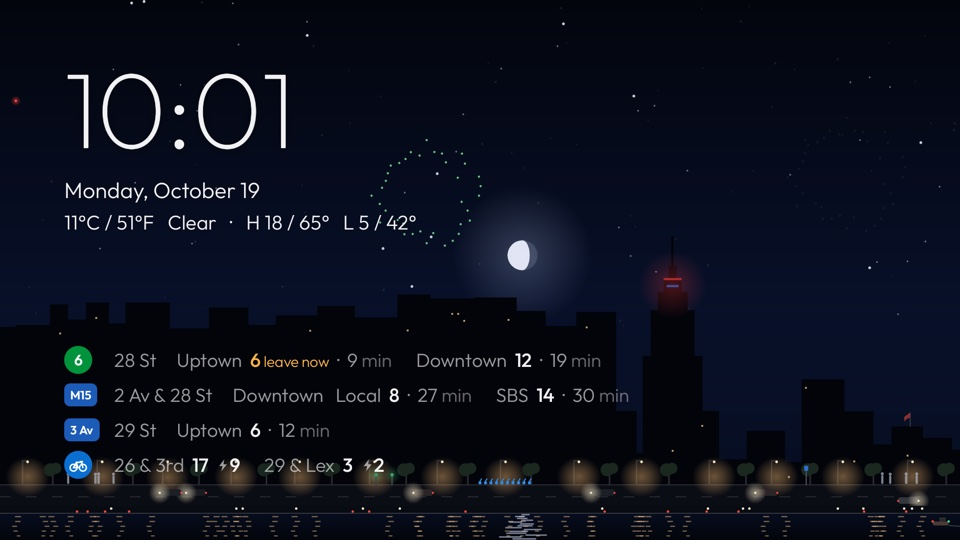
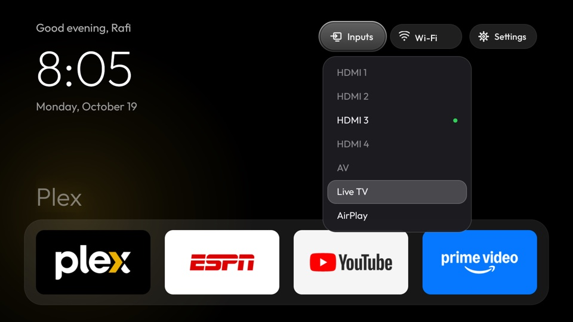

# Glass Home: a debloated Hisense Google TV with an Apple TV-style home screen

Scripts that debloat a Hisense Google TV over ADB, plus **Glass Home**, a small replacement
launcher. Tested on a Hisense "SmartTV 4K FFM" (MediaTek, Google TV on Android 12).

- **Debloat:** 41 packages disabled (Hisense tracking and ads, preloaded extras, unused apps).
  Nothing is uninstalled, and one script undoes it all.
- **Glass Home:** black background, clock and greeting, a 4-app dock, an app grid, an Inputs
  menu, and a live-sky screensaver with NYC transit, Citi Bike and weather. Navigation with the remote is predictable, and the launcher uses about 30 MB of RAM.



<details>
<summary>More screenshots</summary>

| | |
|---|---|
|  |  |
| Night, with live transit and a game on | An autumn afternoon |
|  |  |
| Rain blowing with the real wind | December: snow, holiday lights, red and green crown |
|  |  |
| Fireworks on July 4th | The Inputs menu |

</details>

## Quick start

Requirements: `adb`, JDK 17 and the Android SDK (platform 34). On macOS:

```sh
brew install --cask android-platform-tools android-commandlinetools && brew install openjdk@17
export JAVA_HOME=/opt/homebrew/opt/openjdk@17
sdkmanager "platforms;android-34" "build-tools;34.0.0"
```

On the TV, turn on Developer options (Settings → System → About → press OK on "Android TV OS
build" 7 times), then turn on USB debugging. Then:

```sh
export ANDROID_SERIAL=<tv-ip>:5555
adb connect $ANDROID_SERIAL                       # accept "Allow USB debugging?" on the TV
scripts/install.sh                                # build, install and set Glass Home as home
scripts/disable.sh $(cat disabled_by_us.txt)      # debloat (edit the list first)
```

Turn USB debugging off again when you're done.

## Undo

| To | Run |
|---|---|
| Undo everything | `scripts/restore.sh` (add `--uninstall-launcher` to remove Glass Home too) |
| Re-enable one app | `adb shell pm enable --user 0 <package>`, then remove it from `disabled_by_us.txt` |
| Disable another app | `scripts/disable.sh <package>` |
| Re-apply after a firmware update | `scripts/disable.sh $(cat disabled_by_us.txt) && scripts/install.sh --no-build` |

On the TV itself: Settings → Apps → See all apps → pick a disabled app → Enable.

## Customise

**Dock apps** (takes effect immediately; `--es dock default` resets it):

```sh
adb shell am broadcast -n com.rafi.glasshome/.ConfigReceiver -a com.rafi.glasshome.SET_DOCK \
  --es dock "com.plexapp.android,com.espn.score_center,com.google.android.youtube.tv,com.amazon.amazonvideo.livingroom"
```

To change the permanent default, edit `default_dock` in
`launcher/app/src/main/res/values/config.xml` and run `scripts/install.sh`.

**Greeting name:** `... -a com.rafi.glasshome.SET_NAME --es name "Your name"`. Use `--esn name`
for no name.

**Wallpaper** (black by default):

```sh
adb push photo.jpg /sdcard/Android/data/com.rafi.glasshome/files/wallpaper.jpg   # then press Home
adb shell rm /sdcard/Android/data/com.rafi.glasshome/files/wallpaper.jpg         # back to black
```

**Now playing:** while Spotify plays on the TV, a small card under the top-right pills shows the
cover, title, artist and progress, tinted from the cover; it dims when paused and disappears when
nothing's playing. It needs Glass Home's notification listener (Android's rule for seeing other
apps' music), which `install.sh` turns on; the listener ignores notifications. More apps can be
added to `now_playing_apps` in `config.xml`.

**Remote app buttons:** with the stock launcher disabled, the YouTube and Prime buttons need
Glass Home's "remote buttons" accessibility helper. It sees key presses only, not the screen. The
mapping is `remote_buttons` in `config.xml`. To find another button's keycode, press it and run
`adb logcat -d | grep "IR keycode"`.

## Screensaver and live data

The screensaver is Midtown right now, seen from Queens across the East River:

- **Sky:** colours follow today's real sunrise and sunset; the moon shows its real phase (bigger
  and brighter when full); meteors streak by during the real showers (Quadrantids, Lyrids, Eta
  Aquariids, Perseids, Orionids, Leonids, Geminids).
- **Weather:** clouds, rain, snow, fog and lightning, all moving with the real wind; a rooftop flag
  shows its direction. Snow settles on the rooftops when there's snow on the ground.
- **City:** the skyline with the Empire State Building, its crown lit in holiday colours
  (Christmas, New Year, Valentine's, St Patrick's, Pride, July 4th, Halloween), with fireworks
  over the skyline on July 4th and at midnight on New Year's Eve.
- **Street:** cars and taxis, cyclists, people (with umbrellas in the rain), streetlights and
  windows that come on through the evening, and street trees through the seasons: blossom,
  green, autumn colours, bare, with lights from 1 December to 6 January.
- **River:** the FDR's headlight streams, city lights and the sun or moon shimmering on the
  water, and the odd ferry or tug.

Some of it follows the live data:

- when a 6 train is due at 28 St, the subway entrance's green globes brighten and people walk out;
- when an M15 or 3rd Ave bus is arriving, a bus pulls into the stop;
- the little Citi Bike dock holds as many bikes as the real one at 26 & 3rd;
- on game days a rooftop sign shows the score.

Over the skyline: the time, the weather in °C / °F, and four transit rows (6 train at 28 St,
M15 local + SBS at 2 Av & 28 St, M101/M102/M103 uptown at 3 Av & 29 St, and classic + e-bikes at
two Citi Bike docks). Departures sooner than your walk to the stop are left out; the next one
turns **amber with "leave now"** when it's time to go. The home screen shows a one-line version of
the same thing under the date, and a faint sky tint at the top.

| Data | Source | Refresh |
|---|---|---|
| Weather, sunrise/sunset | Open-Meteo (no key) | 15 min |
| 6 train | MTA GTFS-realtime (no key) | 30 s |
| Buses | MTA Bus Time (free key, see below) | 30 s |
| Citi Bike | GBFS station status (no key) | 2 min |
| Scores | ESPN scoreboard (no key, undocumented) | 1 min during a game, else 15 min |

All fetching happens on one low-priority background thread, only while the screensaver or the
home screen is showing, with 4–6 s timeouts. A failed request keeps the last good data, and
nothing older than 3 minutes is shown.

**Your stops, walk times and stations** are in `launcher/app/src/main/res/values/screensaver.xml`,
and **your teams** in `sports.xml` (Blue Jays, Leafs, Raptors, TFC, Giants; ESPN no longer carries
the CFL, so no Argonauts). Edit and run `scripts/install.sh`.

**About panel:** long-press OK on the Settings pill (or press Info/Menu) on the home screen. It
shows the version, when each data source last updated (or its error), memory, and whether the
screensaver, ad-blocking DNS and remote-button helper are on.

**Bus key:** get one free at https://register.developer.obanyc.com/ and give it to the TV (it's kept
on the TV only, never in this repo):

```sh
adb shell am broadcast -n com.rafi.glasshome/.ConfigReceiver -a com.rafi.glasshome.SET_BUS_KEY --es key YOUR_KEY
```

Without a key, buses fall back to the endpoint the Bus Time website itself uses, which works but
is undocumented.

**Preview** any weather or time of day while the screensaver is running (`off` = live):

```sh
adb shell am start -n com.android.systemui/.Somnambulator      # start the screensaver now
adb shell am broadcast -n com.rafi.glasshome/.ConfigReceiver -a com.rafi.glasshome.PREVIEW_SKY --es mood rain --ef hour 19.5 --es date 12-20
#   mood: clear | partly | cloudy | fog | drizzle | rain | snow | storm | live | off   (date is optional, MM-DD)
adb shell am broadcast -n com.rafi.glasshome/.ConfigReceiver -a com.rafi.glasshome.PREVIEW_SKY --es event bus   # train | fireworks | meteor
```

**Timing** (ms): `adb shell settings put system screen_off_timeout 600000` starts it after 10 min,
`adb shell settings put secure sleep_timeout 1200000` puts the TV to sleep after 20. Back to Google's
Ambient mode: `adb shell settings put secure screensaver_components com.google.android.apps.tv.dreamx/.service.Backdrop`.

**Cost:** about 60 MB of RAM. With the TV otherwise idle, the whole TV runs at roughly 26% CPU with
the screensaver on a clear night and a bit over 30% in heavy rain (13% on the home screen).

## If something breaks

**Black screen on Home, no computer needed.** The Settings button doesn't work on that screen,
but Input does:

1. Press **Input** and choose **TV**.
2. Press **Settings**.
3. Go to Apps → See all apps, pick **Google TV**, then choose **Enable**.
4. Press Home. You're back on the stock home screen.

**YouTube or Prime buttons stopped working** (usually after a reinstall): Settings →
Accessibility → Glass Home remote buttons, switch it off and on, or run
`scripts/install.sh --no-build`. Injected keys (`adb shell input keyevent`) skip this helper, so
test with the real remote.

**Last resort:** Settings → System → About → Factory reset.

<details>
<summary>What gets disabled, and what stays</summary>

| Group | Packages |
|---|---|
| Tracking | `com.vt.tv.evservice` (viewing tracking), `com.vt.tv.smartservice` (log reporting), `com.google.android.feedback` |
| Ads and content | `net.vidaatv.hisense.android.tv`, `com.vidaa.oemtabcontentprovider`, `com.vt.tv.customerlauncher`, `android.autoinstalls.config.google.gtvpai` |
| Background | `com.vt.storemode`, `com.vt.tv.aiot`, `tv.mopa.ginga`, `com.vt.tv.dlna`, `com.vt.tv.protector` |
| Extras | Alexa, Hisense browser, Play Games, HiShow, Media Center, BT Music, Miracast |
| Streaming | 20 apps; see `disabled_by_us.txt` |
| Home screen | `com.google.android.apps.tv.launcherx`, `com.google.android.tungsten.setupwraith` |

Kept on purpose: Live TV, all inputs and the Inputs menu, the remote and Bluetooth, keyboard,
Play Store and Services, DRM, Dolby, system updates, Assistant, Chromecast, AirPlay.
`com.vt.tv.smartsense` still sends some usage reports, but it also handles the remote and input
switching, so it stays.

</details>

<details>
<summary>Notes on how it works</summary>

- **Why the setup wizard is disabled:** the Google TV launcher outranks every other home app
  (HOME priority 2). Once it's disabled, the setup wizard's RecoveryActivity (priority 1) takes
  over with a black screen. ADB can't disable a single screen of a system app, so the whole
  wizard is disabled. System updates still work.
- **Inputs menu:** switches through the TV input framework. AirPlay registers as a tuner on this
  TV, so only the hardware tuner (`/HW` in its input ID) is treated as Live TV.
- **Wi-Fi name:** Android only shows it to apps with location permission, which
  `install.sh` grants.
- **Ad-blocking DNS (optional):** `adb shell settings put global private_dns_specifier
  dns.adguard-dns.com && adb shell settings put global private_dns_mode hostname`. It doesn't
  block YouTube ads. Undo with `private_dns_mode opportunistic`.
- **macOS "No route to host":** macOS Local Network privacy is blocking `adb`. The Python
  `adb-shell` package works as a fallback.

</details>

The Outfit font is under the SIL Open Font License (`launcher/app/src/main/assets/fonts/OFL.txt`).
